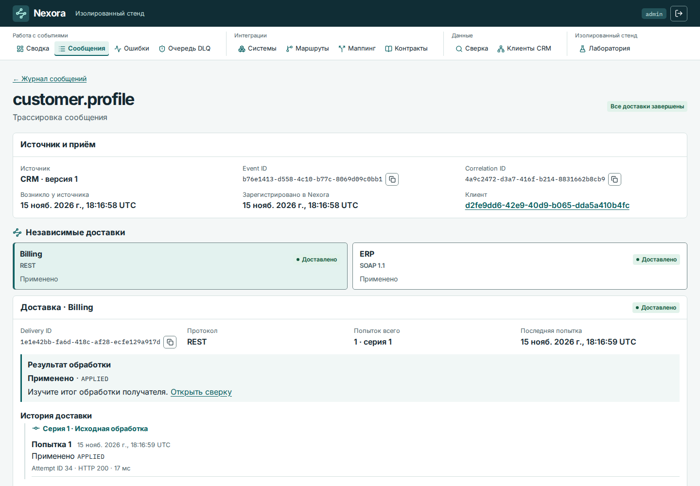

# Nexora

Учебная платформа интеграции корпоративных систем / Educational enterprise integration platform.

**[Русский](README.ru.md) · [English](README.en.md)**

CRM REST → RabbitMQ → Nexora → ERP SOAP + Billing REST. Independent PostgreSQL storage, version-aware delivery, retries, quarantine and reconciliation.

```sh
docker compose up --build
```

[Локальная консоль / Local console](http://127.0.0.1:8090) · [Архитектура / Architecture](docs/architecture/design.md) · [Результаты проверок / Results](docs/testing/results.md)

[Редизайн / UX redesign](docs/ux-ui-redesign.md) · [Приёмка / Acceptance](docs/testing/ux-acceptance.md)


